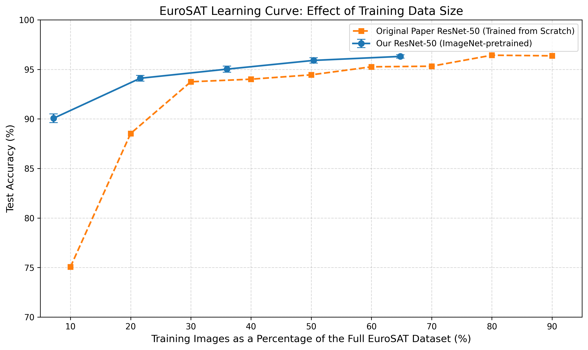

# Part A – Improvement: Training Data Efficiency

## 1. Overview

This improvement investigates how the amount of labelled training data affects EuroSAT image classification performance using a transfer learning approach.

The objective is to evaluate whether an ImageNet-pretrained ResNet-50 can achieve strong classification performance with different amounts of training data, reducing the dependence on large labelled datasets.

## 2. Proposed Improvement

The original paper uses a ResNet-50 trained from scratch. In this project, we investigate an alternative approach using **ImageNet-pretrained ResNet-50**.

Instead of training the entire network from random initialisation, the model benefits from previously learned visual features and is adapted to the EuroSAT dataset through transfer learning.

The experiment evaluates five training-data proportions:

- 10%
- 30%
- 50%
- 70%
- 90%

Each experiment is repeated using three random seeds (42, 43 and 44) to examine the consistency of the results.

This results in 15 experimental runs.

## 3. Experimental Setup

- **Dataset:** EuroSAT RGB
- **Number of classes:** 10
- **Model architecture:** ResNet-50
- **Initialisation:** ImageNet pretrained weights
- **Training strategy:** Transfer learning
- **Training proportions:** 10%, 30%, 50%, 70% and 90% of the training partition
- **Random seeds:** 42, 43 and 44
- **Evaluation:** Validation and test performance

The dataset split is kept fixed across the experiments to ensure consistent evaluation.

## 4. Results and Comparison

The learning curve below compares the test accuracy of our ImageNet-pretrained ResNet-50 with the ResNet-50 trained from scratch reported in the original paper.

The comparison illustrates how the pretrained model performs across different training-data proportions.

The results indicate that transfer learning can achieve strong classification performance even when only a limited proportion of the available training data is used.

## 5. Key Findings

- ImageNet pretraining provides a strong starting point for EuroSAT classification.
- Classification performance improves as more training data becomes available.
- The pretrained model achieves approximately 90% test accuracy at the smallest evaluated training proportion.
- Performance gains become smaller as the training-data proportion increases.
- Repeating experiments with three random seeds helps assess the stability of the results.

## 6. Reproducibility

The implementation and detailed experimental results are available in the parent `Part A` folder.

Refer to the following files:

- `EuroSAT_Part_A_Label_Efficiency.ipynb` – experimental implementation and analysis.
- `part_a_test_results.csv` – test evaluation results.
- `part_a_results_summary.csv` – aggregated experimental results.
- `part_a_validation_summary.csv` – validation performance.
- `part_a_combined_training_history.csv` – training history across experiments.

## 7. Conclusion

This improvement investigates the effectiveness of transfer learning for data-efficient EuroSAT image classification.

The experiments demonstrate the potential of ImageNet-pretrained ResNet-50 to achieve strong classification performance with reduced labelled training data. This provides an alternative to training the network entirely from scratch.
