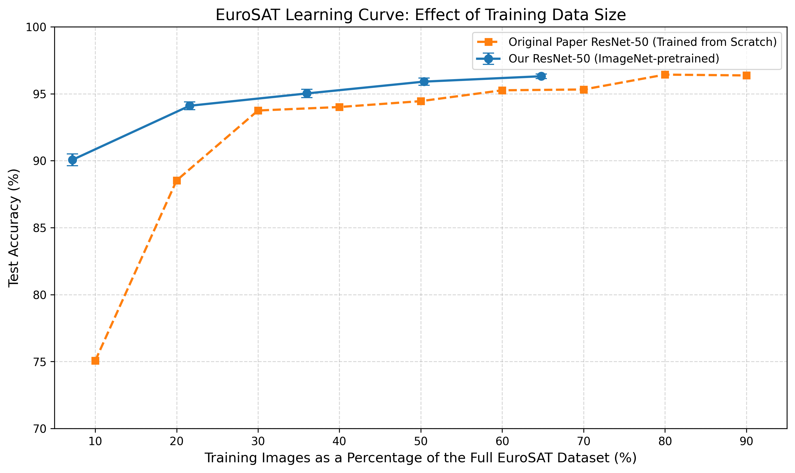

# Part A – Evaluating Label Efficiency

## 1. Overview

This part of the project investigates how the availability of labelled training data affects EuroSAT land-use and land-cover classification performance.

The main objective is to evaluate how the amount of labelled training data affects the classification performance of an ImageNet-pretrained ResNet-50 model.

The experiment also compares our results with the ResNet-50 learning curve reported in Table II of the original EuroSAT research paper.

## 2. Individual Contribution

**Student:** Sushma  
**Contribution:** Part A – Effect of Pretraining with Limited Training Data

The individual improvement investigates whether ImageNet pretraining can help a ResNet-50 model achieve strong classification performance when only a limited amount of labelled EuroSAT training data is available.

The original paper's learning curve provides a reference for comparing performance at different training-data sizes. Our experiments use an ImageNet-pretrained ResNet-50 and evaluate its performance across different training-data proportions.

### Research Question

How does the amount of labelled training data affect the classification performance of an ImageNet-pretrained ResNet-50 on the EuroSAT dataset?

### Hypothesis

We hypothesise that an ImageNet-pretrained ResNet-50 will achieve strong classification performance even with limited EuroSAT training data. We expect classification accuracy to improve as more labelled training data becomes available, with smaller performance gains at higher training-data proportions.

The comparison with the original paper's scratch-trained ResNet-50 learning curve provides an indicative reference, rather than a controlled measurement of the effect of pretraining alone.

## 3. Dataset

The experiments use the EuroSAT RGB dataset.

| Property | Description |
|---|---|
| Dataset | EuroSAT RGB |
| Total images | 27,000 |
| Number of classes | 10 |
| Image dimensions | 64 × 64 pixels |
| Input channels | 3 (RGB) |

### Dataset Split

A fixed stratified split was used across the experiments.

| Partition | Images | Percentage |
|---|---:|---:|
| Training | 19,440 | 72% |
| Validation | 2,160 | 8% |
| Test | 5,400 | 20% |
| **Total** | **27,000** | **100%** |

The same validation and test partitions were maintained across all training-data experiments to ensure consistent evaluation.

The shared dataset split and class mapping are reused from the baseline experiment.

## 4. Experimental Methodology

### Model Architecture

- **Architecture:** ResNet-50
- **Initialisation:** ImageNet-pretrained weights
- **Framework:** PyTorch
- **Dataset:** EuroSAT RGB
- **Training approach:** Two-stage transfer learning, consisting of classification-head training followed by full-network fine-tuning.

### Training Configuration

| Parameter | Configuration |
|---|---|
| Optimiser | AdamW |
| Batch size | 64 |
| Classification-head training | 3 epochs |
| Full-network fine-tuning | 7 epochs |
| Head learning rate | 0.01 |
| Fine-tuning learning rate | 0.0001 |
| Weight decay | 0.0001 |
| Input normalisation | ImageNet mean and standard deviation |

### Training-Data Proportions

Five proportions of the original training partition were evaluated.

| Training proportion | Number of training images |
|---|---:|
| 10% | 1,944 |
| 30% | 5,832 |
| 50% | 9,720 |
| 70% | 13,608 |
| 90% | 17,496 |

Each experiment was repeated using three random seeds:

- 42
- 43
- 44

Therefore, a total of **15 experimental runs** were conducted.

Stratified sampling was used to preserve class representation across training subsets. The validation and test sets remained fixed for all experiments.

## 5. Evaluation Metrics

The model performance was evaluated using:

- Accuracy
- Macro precision
- Macro recall
- Macro F1-score
- Confusion matrices
- Class-wise classification reports

Mean and standard deviation across the three random seeds were calculated to examine the consistency of the results.

## 6. Experimental Results

The following table presents the mean test accuracy and standard deviation across the three random seeds.

| Training proportion | Mean test accuracy ± SD |
|---|---:|
| 10% | 90.07% ± 0.43 pp |
| 30% | 94.10% ± 0.30 pp |
| 50% | 95.02% ± 0.32 pp |
| 70% | 95.91% ± 0.27 pp |
| 90% | 96.31% ± 0.17 pp |

The results indicate that classification accuracy improves as more labelled training data is provided. The improvements become smaller at higher training-data proportions.

### Learning Curve and Comparison

The following figure compares our ImageNet-pretrained ResNet-50 with the scratch-trained ResNet-50 learning curve reported in Table II of the original EuroSAT paper.



The comparison illustrates the performance of the pretrained model across different training-data sizes relative to the original paper's reported learning curve.

This comparison should be interpreted in the context of the respective experimental setups and data-splitting procedures.

## 7. Key Findings

- The ImageNet-pretrained ResNet-50 achieved 90.07% mean test accuracy using 10% of the training partition.
- Increasing the training-data proportion improved classification performance.
- The highest mean test accuracy was 96.31%, achieved using 90% of the training partition.
- The improvement in accuracy became smaller as the training-data proportion increased.
- Repeating the experiments with three random seeds provided an assessment of result consistency.

These findings demonstrate the importance of evaluating model performance at different levels of labelled data availability.

## 8. Repository Structure

The Part A folder contains the following files and directories:

| File or folder | Description |
|---|---|
| `EuroSAT_Part_A_Label_Efficiency.ipynb` | Main experimental notebook containing implementation and analysis |
| `part_a_combined_training_history.csv` | Epoch-wise training history across experimental runs |
| `part_a_results_summary.csv` | Aggregated experimental results |
| `part_a_validation_summary.csv` | Validation performance summary |
| `part_a_test_results.csv` | Test evaluation results |
| `Classification_Reports/` | Class-wise classification reports |
| `Confusion_Matrices/` | Confusion matrix CSV files |
| `Improvement/` | Individual improvement description and learning-curve visualisation |

The shared dataset split and class mapping are reused from the shared project files rather than duplicated in Part A.

## 9. Reproducibility

The experiments were implemented using Python, PyTorch and Google Colab. Google Drive was used for accessing the dataset, shared split files, checkpoints and experiment outputs.

### 9.1 Requirements

The following are required to reproduce the experiments:

- Python environment compatible with the versions specified in `requirements.txt`.
- Google Colab or an equivalent Python environment with GPU support recommended.
- PyTorch and Torchvision.
- NumPy and Pandas.
- Scikit-learn.
- Matplotlib and Seaborn.
- Pillow.
- Google Drive access when using the original notebook configuration.
- EuroSAT RGB dataset.
- Shared dataset split file: `eurosat_splits.csv`.
- Shared class mapping file: `class_to_idx.json`.
- Repository `requirements.txt` file.

Install the dependencies using:

```bash
pip install -r requirements.txt
```

### 9.2 Required Google Drive Structure

The notebook expects the following directory structure in Google Drive:

```text
MyDrive/
└── EuroSAT_Final_Experiments/
    ├── Shared/
    │   ├── Dataset/
    │   │   └── EuroSAT RGB dataset
    │   └── Dataset_Splits/
    │       ├── eurosat_splits.csv
    │       └── class_to_idx.json
    │
    ├── Baseline/
    │   ├── Checkpoints/
    │   ├── Logs/
    │   └── Results/
    │
    └── Part_A/
        ├── Checkpoints/
        ├── Logs/
        └── Results/
```

The dataset directory must contain the EuroSAT RGB images organised by their class folders, consistent with the image paths recorded in the split CSV.

The shared split CSV must contain the image paths, class names and split assignments required by the notebook. The class mapping JSON must contain the corresponding class-to-index mapping.

### 9.3 Steps to Reproduce

1. Clone the project repository from GitHub.
2. Open `Part A/EuroSAT_Part_A_Label_Efficiency.ipynb` in Google Colab.
3. Install the dependencies using the repository's `requirements.txt`.
4. Mount Google Drive when prompted by the notebook.
5. Place the EuroSAT RGB dataset in `Shared/Dataset/` within the expected Google Drive project directory.
6. Make sure `eurosat_splits.csv` and `class_to_idx.json` are available in `Shared/Dataset_Splits/`.
7. Ensure the Google Drive project directories are configured according to Section 9.2.
8. Run the notebook cells in order, starting with the imports and path configuration.
9. Execute the dataset preparation and training-subset generation cells.
10. Run the experiments for all five training proportions and three random seeds.
11. Run the evaluation cells to generate test metrics, classification reports and confusion matrices.
12. Review the generated result summaries and learning curve.

### 9.4 Reproducibility Configuration

The experiments use the following fixed configuration:

- Training proportions: 10%, 30%, 50%, 70% and 90%.
- Random seeds: 42, 43 and 44.
- Fixed training, validation and test partitions.
- ImageNet-pretrained ResNet-50.
- Two-stage training with AdamW.
- Batch size of 64.
- Three classification-head training epochs and seven full-network fine-tuning epochs.

The best model checkpoint for each experiment is selected using validation accuracy.

The same fixed test set of 5,400 images is used to evaluate each training-data proportion and construct the learning curve. It is not used for training or checkpoint selection.

**Note:** The notebook saves checkpoints, training histories and evaluation outputs in Google Drive. Reproducing the original results requires the same dataset, shared split files, model configuration and random seeds. GPU hardware and software versions may also affect exact reproducibility.

## 10. Conclusion

Part A evaluates the effect of training-data availability on EuroSAT image classification using an ImageNet-pretrained ResNet-50.

Across five training-data proportions and three random seeds, the experiments demonstrate that strong classification performance can be achieved even with a reduced amount of labelled training data.

The findings provide insight into the relationship between pretraining, labelled data availability and classification performance in satellite image classification.
