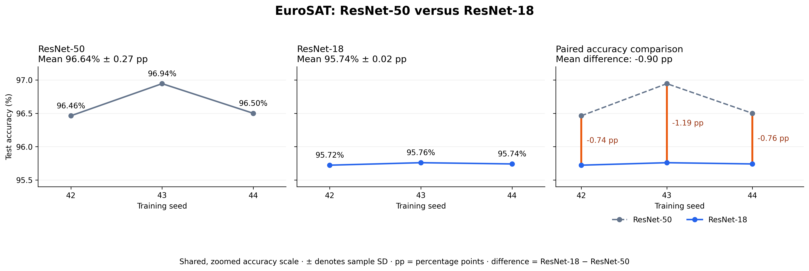

# Part B: Evaluating a Smaller Network

**Author:** Ishika Thakur

## Objective and hypothesis

This experiment evaluates ImageNet-pretrained ResNet-18 as a
smaller alternative to our shared ResNet-50 baseline.

**Hypothesis:** Under the same dataset split and training settings,
ResNet-18 will achieve mean test accuracy no more than one
percentage point below ResNet-50, while using fewer parameters
and requiring less training time.

## Experimental settings

Following the professor's approval, we retained the original
presentation baseline. Baseline gap investigations are documented
separately in `../baseline_checks/`.

| Setting | Configuration |
|---|---|
| Dataset | EuroSAT RGB: 27,000 images, 10 classes |
| Input | 64 × 64 RGB |
| Split | 72% training, 8% validation, 20% test |
| Split seed | 42; split fixed across training runs |
| Training seeds | 42, 43 and 44, as approved by the professor |
| Preprocessing | Tensor conversion and ImageNet normalisation |
| Augmentation | None |
| Optimiser | AdamW |
| Weight decay | 0.0001 |
| Batch size | 64 |
| Head training | 3 epochs; learning rate 0.01 |
| Full-network fine-tuning | 7 epochs; learning rate 0.0001 |
| Checkpoint selection | Highest validation accuracy across both stages; earlier checkpoint retained on an exact tie |
| Final evaluation | Selected checkpoint evaluated on the held-out test set |

The architecture and its corresponding ImageNet-pretrained
weights change. ResNet-18 uses `IMAGENET1K_V1` weights.
Validation and test images remain the same for both networks.

## Results

| Seed | ResNet-50 test accuracy (%) | ResNet-18 test accuracy (%) | Difference (pp) |
|---|---:|---:|---:|
| 42 | 96.4630 | 95.7222 | −0.7408 |
| 43 | 96.9444 | 95.7593 | −1.1851 |
| 44 | 96.5000 | 95.7407 | −0.7593 |
| Mean | 96.6358 | 95.7407 | −0.8951 |

Difference means **ResNet-18 minus ResNet-50**.

- ResNet-50 mean accuracy: **96.64% ± 0.27 pp**.
- ResNet-18 mean accuracy: **95.74% ± 0.02 pp**.
- Spread denotes sample standard deviation across three seeds.
- ResNet-18 parameters: **11,181,642**.
- Ten-class ResNet-50 parameters: **23,528,522**.
- Parameter reduction: approximately **52.5%**.
- Recorded ResNet-18 training times: approximately **2.74–2.87 minutes per run**.

ResNet-18 mean macro precision was **95.6494%**, macro recall
was **95.5183%**, and macro F1 was **95.5685%**.

A training-speed improvement should only be claimed after comparing
the baseline's recorded times using comparable hardware and the
same timing definition.

## Statistical comparison

The comparison pairs the two networks by training seed.

- Two-sided paired t-test: **t(2) = −6.17, p = 0.0253**.
- 95% confidence interval for the mean accuracy difference:
  **[−1.52, −0.27] percentage points**.
- Exact Wilcoxon signed-rank test: **W = 0, p = 0.25**.

These calculations use the displayed per-seed accuracies rounded
to four decimal places.

The observed mean accuracy loss of **0.90 percentage points**
meets our predefined one-point descriptive margin. However,
the confidence interval includes losses larger than one point,
so statistical noninferiority is not established.

Only three paired runs were evaluated on one fixed dataset split.
These results describe variation across training seeds, not across
alternative dataset splits.

## Files

| File | Purpose |
|---|---|
| `PartB_ResNet18_Ishika_Final.ipynb` | Experiment code, saved outputs and statistical comparison |
| `improved_seed42.json`, `improved_seed43.json`, `improved_seed44.json` | Per-seed metrics, configuration, parameter count and training time |
| `resnet18_test_results.csv` | Per-seed test metrics |
| `resnet18_test_summary.csv` | Mean and standard deviation of test metrics |
| `resnet18_validation_results.csv` | Validation-selected epoch, accuracy and training time per seed |
| `resnet18_validation_summary.csv` | Validation summary |
| `resnet18_training_history.csv` | Combined epoch histories |
| `resnet18_seed_*_training_history.csv` | Individual training histories |
| `resnet18_seed_*_classification_report.csv` | Per-class evaluation metrics |
| `resnet18_seed_*_confusion_matrix.csv` | Confusion matrices; rows are true classes, columns are predictions |
| `resnet18_training_validation_accuracy.png` | Training and validation accuracy curves |
| `resnet18_training_validation_loss.png` | Training and validation loss curves |
| `paired_runs-2.png` | Paired baseline versus Part B accuracy comparison |
| `resnet18_baseline_results_summary.csv` | ResNet-18 results table; filename retained from the original export |

## How to run

### View the completed results

Open `PartB_ResNet18_Ishika_Final.ipynb` on GitHub to inspect its
saved outputs. The CSV and JSON files can also be read directly
without training.

### Reproduce the experiment in Google Colab

1. Open `PartB_ResNet18_Ishika_Final.ipynb` in Google Colab.
2. Select **Runtime → Change runtime type → T4 GPU**.
3. Mount your own Google Drive when prompted.
4. Run the environment and dataset-preparation cells in order.
   The dataset cell downloads and checks the official EuroSAT RGB
   archive. Allow time for the dataset to copy to Drive.
5. Use the same frozen split assignments as the shared baseline.
   The notebook includes deterministic split-generation code with
   split seed 42; compare its assignments with the shared baseline
   split before training, and avoid overwriting an existing split.
6. Keep the documented settings and seeds `[42, 43, 44]`.
7. Run the training section, followed by test evaluation and the
   statistical-comparison and plotting cells.
8. Run the export cell to generate the per-seed JSON files.

The notebook uses these Google Drive locations:

- Shared data and splits:
  `/content/drive/MyDrive/EuroSAT_Final_Experiments/Shared/`
- Original training outputs:
  `/content/drive/MyDrive/EuroSAT_Final_Experiments/Baseline/`
- Copied Part B outputs and exports:
  `/content/drive/MyDrive/EuroSAT_Final_Experiments/improvement_ishika/`

The final export cell copies files whose names begin with
`resnet18` into the Part B location.

Running the training cell starts all three training runs and can
overwrite files with matching names. To inspect existing results,
load the saved CSVs instead of rerunning training.

## Model checkpoints

[Download ResNet-18 checkpoints](/content/drive/MyDrive/EuroSAT_Final_Experiments/improvement_ishika/Checkpoints)

The Drive folder contains:

- `resnet18_seed_42.pth`
- `resnet18_seed_43.pth`
- `resnet18_seed_44.pth`

Each checkpoint contains the weights selected using validation
accuracy. Download the checkpoints into the notebook's configured
`CHECKPOINT_DIR` to evaluate them without retraining.

The original checkpoint metadata may retain the label
`ResNet-50`; the training and evaluation code constructs ResNet-18,
and the saved weights belong to that architecture.

## Contribution

Ishika Thakur conducted the Part B ResNet-18 experiment and
baseline gap checks, and prepared the Part B evaluation,
statistical comparison and documentation.

The shared ResNet-50 baseline is used by both project parts.
Sushma's training-data-size experiment is documented in Part A.
