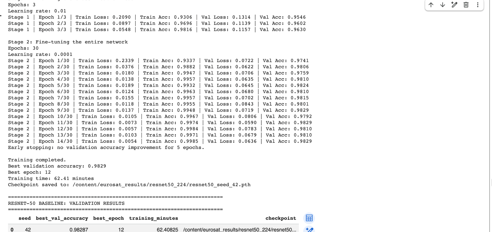

# Baseline Checks
Conducted after the professor’s feedback.

## 01_ResNet50_Training_Length_and_Resize.ipynb

Investigates training duration and input image size using the
existing 72% training, 8% validation and 20% test split.

- Extends fine-tuning beyond the original seven epochs.
- Uses early stopping with patience 5 and a maximum of 30
  fine-tuning epochs.
- Tests resizing inputs from 64 × 64 to 224 × 224.
- Uses seed 42 and validation accuracy for checkpoint selection.

Recorded results:
- 64 × 64: 97.87% validation accuracy; 10.95 minutes.
- 224 × 224: 98.29% validation accuracy; 62.41 minutes.

The recovered revision contains the resizing code and partial
training outputs. Final results are documented separately in
retained screenshots/output records. The 224 × 224 checkpoint
and original CSV files were lost when the runtime ended.
## Retained output: 224 × 224 experiment

Single run using seed 42. Best validation accuracy: 98.29%.
Total runtime: 62.41 minutes.
Best overall epoch: 12 (fine-tuning epoch 9).

The screenshot preserves the completed console output.
The checkpoint and original CSV files were lost after the
Colab runtime ended; test accuracy is unavailable.

## 02_ResNet50_Full80_Training_and_Evaluation.ipynb

Investigates training on the full 80% development set.

- Combines the previous training and validation sets:
  21,600 training images.
- Keeps the same 5,400 test images.
- Uses 64 × 64 inputs and seed 42.
- Trains the classification head for three epochs, then
  fine-tunes the full network for fifteen epochs.
- Fixes training duration using the earlier 64 × 64 validation
  experiment; does not use validation-based early stopping.
- Saves configuration, splits, training history, test metrics
  and predictions.
- Generates a confusion matrix and three river/highway
  misclassification examples.

Test accuracy: 97.02%.
Remaining gap to the paper’s 98.57%: 1.55 percentage points.

## Optimiser choice: AdamW

Both notebooks use AdamW with weight decay 0.0001.
The learning rate is 0.01 for head training and 0.0001
for full-network fine-tuning.

AdamW was an implementation choice because it combines
adaptive parameter updates with decoupled weight decay
for regularisation. It was not a confirmed optimiser
setting from the paper.

We have not compared AdamW with SGD with momentum,
so we do not claim that AdamW is superior.

## Interpretation

These are single-seed baseline investigations, separate from
the three-seed architecture comparison in Part B.
Validation and test accuracies measure different sets and
should not be compared directly.
